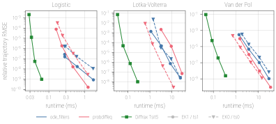
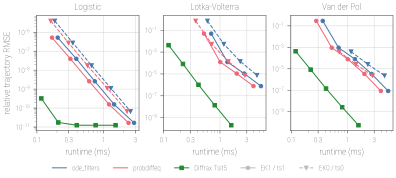

# How it compares

`ode_filters` is one of several libraries for probabilistic ODE solvers. They
share the method — Gaussian filtering and smoothing with the ODE as a
measurement — and differ in what they build around it. This page sets out the
differences, so that you can pick the one that fits. The facts about the other
libraries were checked against their source in October 2026 (probdiffeq 0.9.2,
ProbNumDiffEq.jl 0.18.0, rodeo 1.1.3); if something has changed since, please
open an issue.

## In one paragraph each

**[probdiffeq](https://github.com/pnkraemer/probdiffeq)** (JAX) is the most
complete and the fastest of the JAX libraries for *solving* ODEs
probabilistically. Its covariance factorizations — dense, isotropic,
block-diagonal and matrix-free — let it scale to large systems; it has
adaptive steps with fixed-point smoothing, IWP, IOUP and exponential priors,
custom residuals and constraints (marked experimental), and log-marginal-
likelihood losses for terminal values and time series.

**[ProbNumDiffEq.jl](https://github.com/nathanaelbosch/ProbNumDiffEq.jl)**
(Julia) brings probabilistic solvers to DifferentialEquations.jl: EK0, EK1,
diagonal EK1 and probabilistic exponential integrators; IWP, IOUP and Matérn
priors; fixed, dynamic and multivariate diffusions; Kronecker, dense and
block-diagonal covariances; the Fenrir, Dalton and filtering data likelihoods;
and manifold updates for invariants.

**[rodeo](https://github.com/mlysy/rodeo)** (JAX) is an inference toolbox. It
offers many interrogations (Chkrebtii, Schober's EK0, Krämer's block-diagonal
EK1, rodeo's own) and many likelihood approximations: basic, Fenrir, Dalton,
DALTON for non-Gaussian data, MAGI and pseudo-marginal MCMC. It steps on a fixed
grid with an IBM prior, block-diagonal per variable, and leaves the diffusion to
the user.

**`ode_filters`** (JAX) is built for inference from data, with the ODE as one
source of information among others: conservation laws, data at any grid node,
and hidden inputs that drive the dynamics. Every solver runs the same
square-root filter step, so these combine with every prior, linearization and
stepping mode.

## Side by side

| | `ode_filters` | probdiffeq | ProbNumDiffEq.jl | rodeo |
| --- | --- | --- | --- | --- |
| Language | JAX | JAX | Julia | JAX |
| Priors | IWP, Matérn, IOUP, joint state–input | IWP, IOUP, exponential | IWP, IOUP, Matérn | IBM |
| Linearization | EK0, EK1, IEKF, statistical (SLR); IEKS and IPLS smoothers | EK0, EK1 | EK0, EK1, diagonal EK1, exponential | EK0, EK1, Chkrebtii, rodeo |
| Covariance | dense | dense, isotropic, block-diagonal, matrix-free | dense, Kronecker, block-diagonal | block-diagonal |
| Steps | fixed (any grid), adaptive | fixed, adaptive | fixed, adaptive | fixed |
| Calibration | none, dynamic, per-component, post-hoc | none, MLE, dynamic | fixed, dynamic, multivariate | manual |
| Additional information | conservation laws, black-box and transformed operators | custom residuals and constraints (experimental) | invariants (manifold updates) | via the interrogation |
| Data | linear Gaussian, per-row masks, any grid node | time series at grid or save points | data times added to the steps | linear Gaussian or custom log-likelihood, on the grid |
| Data likelihoods | sequential, Fenrir, Dalton | time series | Fenrir, Dalton, filtering | basic, Fenrir, Dalton, DALTON, MAGI |
| Hidden inputs | joint priors, consistent initialization, information criteria | no dedicated support | no dedicated support | — |
| Diagnostics | NIS, whitened residuals, autocorrelation | — | — | — |

A dash means we found no dedicated support, not that it cannot be built.

## Which one when

- **Large systems, or speed first.** probdiffeq. `ode_filters` keeps dense
  covariances: a step costs `O(D^3)` in the state dimension `D = d (q + 1)`,
  fine for tens of states and slow for hundreds. Block-diagonal factorizations
  are planned.
- **The Julia ecosystem, or stiff problems with exponential integrators.**
  ProbNumDiffEq.jl.
- **Non-Gaussian data, MAGI, or a wide menu of likelihood approximations.**
  rodeo.
- **`ode_filters`** when the ODE is only part of what you know: when data,
  conservation laws or an unknown input enter the same model; when
  hyperparameters are to be selected from the conditional evidence; when the
  linearization error should enter the uncertainty (statistical linearization,
  the IPLS); or when you want to check a fit with innovation diagnostics.

## Speed

The [work-precision benchmark](https://github.com/paufisch/ode_filters/tree/main/benchmarks)
times `ode_filters`, probdiffeq and Diffrax on three problems, with the prior
of order `q = 3` in float64 on a CPU. With adaptive steps `ode_filters` and
probdiffeq are within a small factor of each other, each ahead on some
problems; on a fixed grid probdiffeq is faster for the same accuracy. Diffrax's
Tsit5, which computes no covariance, is one to two orders of magnitude faster
than either.

<figure markdown="span">
  
  <figcaption><strong>Adaptive steps.</strong> Relative trajectory RMSE against
  the median runtime of one solve, sweeping the tolerance (atol = rtol, 1e-3 to
  1e-9). Colour: library. Circles with solid lines: first-order linearization
  (EK1, probdiffeq's ts1); triangles with dashed lines: zeroth order (EK0, ts0);
  squares: Diffrax's Tsit5. Lower left is better. Points with an error above 1
  are left out.</figcaption>
</figure>

<figure markdown="span">
  
  <figcaption><strong>Fixed grid.</strong> As above, but every solver runs the
  same uniform grid of 80 to 1280 steps, Diffrax with a constant step
  size.</figcaption>
</figure>

Measured on 2026-10-14 on an Apple M4 Pro with JAX 0.8.0, probdiffeq 0.8.0,
Diffrax 0.7.2 and the development version of `ode_filters` (commit `631a50b`).
Each runtime is the median of 20 timing rounds after compilation; the
interquartile range is a few percent of it (at most 11 %), smaller than the
markers. Timings depend on the machine.

## Classical solvers

[Diffrax](https://docs.kidger.site/diffrax/) and SciPy's
[`solve_ivp`](https://docs.scipy.org/doc/scipy/reference/generated/scipy.integrate.solve_ivp.html)
return a point trajectory and are faster for the same accuracy: they compute
no covariance (see [Speed](#speed)). Use them when you need the solution and
nothing else.
